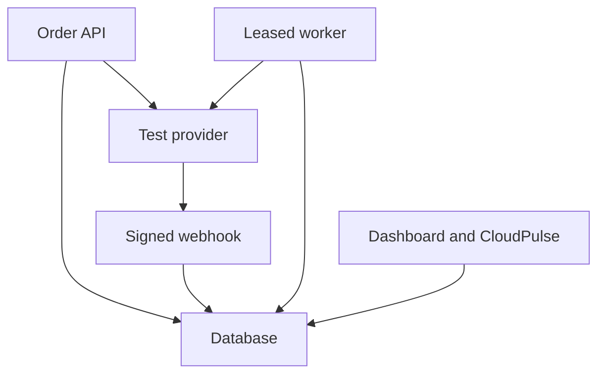

# Architecture and correctness

## The core decision

A webhook request should be short. Verify the raw body, insert an event into a durable inbox, commit, then acknowledge. A worker performs provider reads and business updates later. This avoids tying acknowledgment to payment processing and makes unfinished work recoverable.

The simulator stores provider truth in a separate table inside the same database. This makes it independently queryable and restart-safe without API credentials. It models the boundary; it does not model a genuinely independent provider outage or network.

## Request idempotency

1. Hash the normalized order request and persist the request key with the order.
2. A repeated key with the same parameters reads the existing order.
3. A repeated key with different parameters returns HTTP 409.
4. Create the provider payment with a stable key derived from the persistent order ID.
5. Associate the resulting payment ID with the order.

If the provider succeeds but the local association is interrupted, replaying the order retries provider creation with the same provider key. The simulator checks the unique order association; Stripe receives its HTTP `Idempotency-Key` header. PostgreSQL order creation also handles two transactions racing on the unique request key.

These keys are retained indefinitely by this small lab. Do not assume an external provider retains its idempotency response indefinitely; a deployed integration needs to follow that provider's retention semantics and resolve uncertain operations.

## Inbox and worker ownership

An event ID is unique. Repeated delivery increments `deliveries`; reuse of an event ID with a different payload is rejected. Unknown event types are saved as ignored.

The worker claims an eligible event with a new token and a lease expiry, incrementing its attempt count. A global database control-row lock serializes claims. The provider read occurs outside the transaction. Before committing the result, the worker locks the event, verifies it still owns the token, then locks the order.

One transaction commits the order update, capture/refund entries and the completed-event marker. A late worker whose lease has been taken by another worker cannot apply its stale result. If processing fails, the event becomes pending with a bounded exponential delay. After five attempts it becomes dead. An operator can retry dead work explicitly.

The controlled crash scenario leaves a claimed event unfinished, expires its lease, and verifies that another attempt completes it. It simulates the durable state left by a crash; it does not kill an operating-system process.

## Event order and business effects

Processing fetches current provider truth instead of trusting the event's old status. A delayed failed event therefore cannot undo a captured payment. Distinct event IDs referring to one successful payment still produce one capture effect: the order lock, fulfillment count and unique `capture:<payment_id>` key enforce that invariant together.

Refunds use the cumulative provider refund total. Only the positive increase in that total creates a negative movement entry. For example, a ₹1,499 capture followed by a ₹499 refund creates `+149900` and `-49900` entries, leaving `100000` minor units. A replay does not change the balance. Full refunds move the order to `refunded`; partial refunds to `partially_refunded`.

The simulator locks a payment before checking/refunding its balance. Concurrent requests cannot overdraw it, and replaying a refund key returns its existing refund ID. Stripe refunds use a stable provider key; pending external refunds are reflected locally when the provider reports the completed cumulative amount.

The journal records capture/refund movements. It does not model accounts, fees, settlement, payouts, disputes or double-entry bookkeeping.

## Reconciliation

Reconciliation scans known orders, reads provider state, and queues an internal repair event when a captured payment or refunded amount is missing locally. The same worker transaction applies the repair, so reconciliation uses the same deduplication rules. It currently repairs money/fulfillment drift, not every failed or cancelled status difference.

If a webhook arrives before the API associates the provider payment ID with the order, processing retries the unassociated event instead of losing it.

## Database choices

SQLite uses WAL and `BEGIN IMMEDIATE` because it has no row-level `SELECT FOR UPDATE`; short transactions are serialized. It is convenient for local exploration. PostgreSQL uses row locks, uniqueness constraints and conditional updates. The test fixture can run the same suite against PostgreSQL in isolated schemas; the supplied CI job does that when pushed to GitHub.

The global claim lock favors clarity over throughput. A higher-volume worker could claim rows with `FOR UPDATE SKIP LOCKED`, batch work, and partition by payment/order while preserving the order transaction. API state currently scans the lab's small tables and displays recent rows; it is not a scalable analytics pipeline.

## Authentication and monitoring

Mock mode defaults to a localhost service without an API token. Setting `PAYFLOW_API_TOKEN` protects business API routes and `/metrics`. Webhooks use their signing secret, independent of the API bearer token. Only explicitly test-mode events are accepted. Live keys/objects are rejected by the optional Stripe adapter.

`/health/live` checks that the API responds. `/health/ready` verifies database access. It includes the pause flag but does not prove a separate worker is alive. Queue depth, oldest-event age and dead-event counts reveal processing problems. Recent API p95 uses at most 500 observed `/api/` requests and resets on process restart; it is a diagnostic sample, not an SLO.

## Tradeoffs worth discussing

- The durable inbox keeps queue ownership and business transactions in one system; a separate broker would add delivery/acknowledgment boundaries.
- Provider calls outside database transactions avoid holding order locks through network delays.
- A claim lease makes abandoned work recoverable; claim tokens prevent a former owner from committing after takeover.
- Fetching provider state costs API calls but makes delayed event payloads safer to process.
- Fulfillment is a database effect in this version. Shipping/email integration would need an outbox and idempotent downstream operations.
- This first schema uses `create_all`. A real evolving deployment needs versioned migrations and retention policies before schema changes and sustained traffic.
